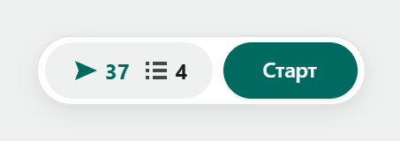
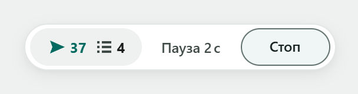
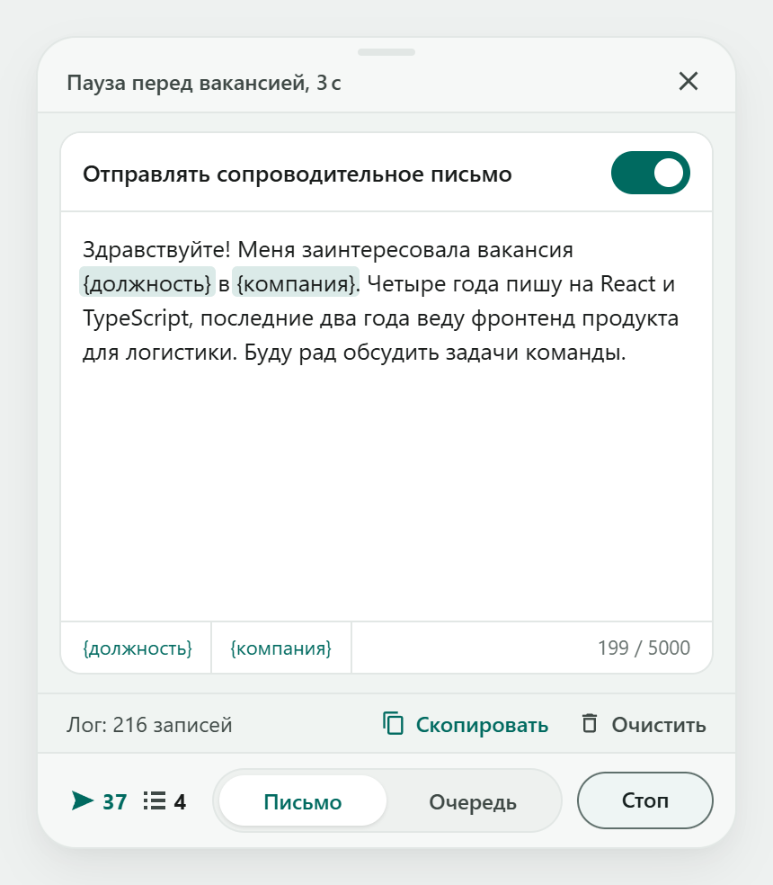
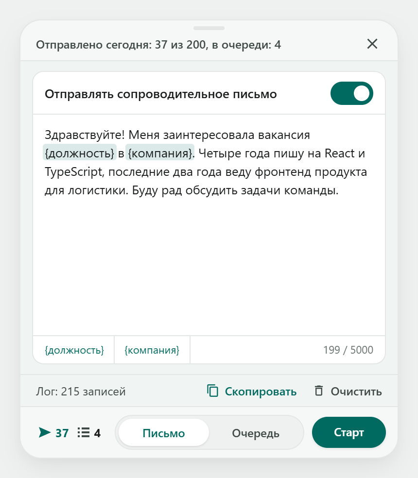
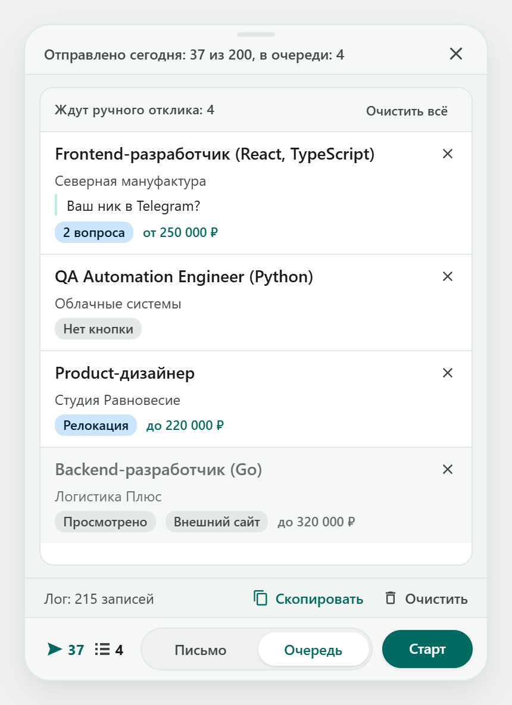
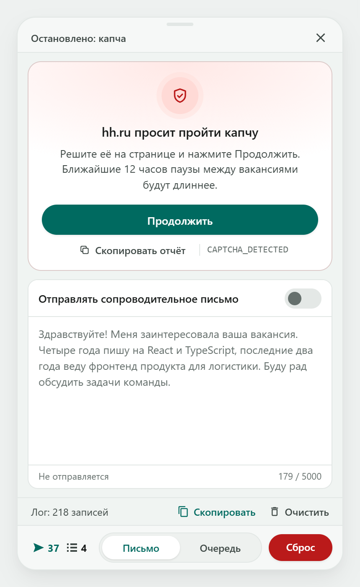

<div align="center">

# HH Apply Assistant

**Userscript для автоматизации откликов на [hh.ru](https://hh.ru)**


[](./LICENSE)

</div>

Я написал этот скрипт, чтобы не кликать вручную по сотням однотипных вакансий каждый день. Скрипт сам открывает вакансии из поиска, жмёт `Откликнуться` и возвращается в выдачу, листая страницы дальше. Если у вакансии есть тест или анкета от работодателя - он не пытается угадывать ответы, а складывает её в список `Ручной отклик`.

> [!WARNING]
> По правилам HeadHunter любая автоматизация запрещена. Автор скрипта не несёт ответственности за возможную блокировку профиля или любые другие ограничения вашего аккаунта. Подробнее - в разделе [Риски](#риски).

Внизу страницы висит плавающий виджет с двумя цифрами:
* цифра у самолётика - отправлено откликов за сегодня. Счётчик считается по вашему времени, обнуляется в полночь и хранится в браузере. Лимит hh считает скользящие 24 часа, поэтому цифры могут не совпадать
* цифра у списка - вакансий в очереди на ручной отклик

Во время работы в пилюле рядом со счётчиком виден текущий шаг (`Пауза 4 с`, `Отклик`, `Жду hh.ru`), во время пауз с обратным отсчётом. Кнопка `Старт` на это время становится круглой кнопкой остановки с квадратом, а по кольцу вокруг неё бежит дуга: так видно, что скрипт работает. Если навести на счётчик, появится подсказка с расшифровкой цифр и полным описанием шага. То же описание есть в строке статуса наверху раскрытой панели. Когда скрипт не работает, там сводка за день, а после остановки итог запуска: сколько времени он шёл и сколько откликов, вакансий в очередь и пропусков за это время, например `За 1 ч 35 мин: 120 откликов, 8 в очередь`. Причина остановки видна в подсказке при наведении на эту строку.

Если запуск требует внимания, это видно и в заголовке вкладки браузера: `Капча | ...` при остановке из-за ошибки (вместо `Капча` будет её причина), `Лимит | ...` при исчерпанном лимите, `Готово: 27 | ...`, когда выдача закончилась. Так остановку заметно в панели вкладок и на панели задач, даже если hh.ru открыт в отдельном окне. После следующего запуска или сброса заголовок становится обычным.

<p align="center">
  
  &nbsp;&nbsp;
  
</p>

Виджет можно перетащить мышкой в удобное место, у краёв экрана он прилипает. Поднять его можно только до высоты, где над ним ещё помещается раскрытая панель. Место запоминается от ближайших краёв окна: если окно ненадолго стало меньше, например открыли DevTools, виджет потом вернётся туда, где был.

---

## Установка

Скрипт работает на `hh.ru` через расширение Tampermonkey. Нужно три шага.

### Шаг 1. Установите Tampermonkey

* Chrome, Brave, Vivaldi, Яндекс Браузер: [Chrome Web Store](https://chromewebstore.google.com/detail/tampermonkey/dhdgffkkebhmkfjojejmpbldmpobfkfo)
* Microsoft Edge: [Microsoft Edge Add-ons](https://microsoftedge.microsoft.com/addons/detail/tampermonkey/iikmkjmpaadaobahmlepeloendndfphd)
* Mozilla Firefox: [Firefox Add-ons](https://addons.mozilla.org/ru/firefox/addon/tampermonkey/)
* Opera: [Tampermonkey Beta в каталоге Opera](https://addons.opera.com/en/extensions/details/tampermonkey-beta/)

### Шаг 2. Разрешите Tampermonkey запускать скрипты

Браузеры на Chromium требуют отдельного разрешения для пользовательских скриптов. Пока оно не включено, скрипты не запускаются, а Tampermonkey может показывать баннер про режим разработчика, даже если он уже включён.

Откройте страницу расширений из таблицы, найдите карточку Tampermonkey и нажмите `Сведения` (в некоторых браузерах `Подробнее`):

| Браузер | Страница расширений | Что включить |
|---|---|---|
| Chrome 138 и новее | `chrome://extensions` | `Разрешить пользовательские скрипты` в сведениях Tampermonkey |
| Brave | `brave://extensions` | то же самое |
| Vivaldi | `vivaldi://extensions` | то же самое |
| Edge | `edge://extensions` | то же самое. В Edge 143 и более ранних версиях этого переключателя нет, там включите `Режим разработчика` на странице расширений |
| Opera | `opera://extensions` | оба пункта: `Режим разработчика` вверху страницы и `Разрешить пользовательские скрипты` в сведениях |
| Яндекс Браузер | `browser://extensions` | `Режим разработчика` (вверху справа) и, если он есть в сведениях Tampermonkey, `Разрешить пользовательские скрипты` |
| Firefox | - | ничего, работает сразу |

Chrome 137 и более ранние версии (версия видна на `chrome://version`) вместо переключателя требует включённый `Режим разработчика` на странице расширений.

После включения перезапустите браузер или выключите и снова включите Tampermonkey.

### Шаг 3. Установите сам скрипт

[](https://raw.githubusercontent.com/tgeruzov/hh-apply-assistant/main/hh-apply-assistant.user.js)

После клика откроется вкладка Tampermonkey - нажмите кнопку `Установить`.

Проверьте установку: откройте [поиск вакансий hh.ru](https://hh.ru/search/vacancy). Внизу страницы должен появиться виджет. Если его нет, вернитесь к шагу 2.

---

## Где работает скрипт

Виджет появляется только на этих страницах hh.ru:

| Страница | Что делает |
|---|---|
| `/search/vacancy` | Основной поиск - отсюда запускается автоматизация |
| `/vacancy/<id>` | Страница вакансии - скрипт нажимает `Откликнуться` |
| `/applicant/vacancy_response` | Форма отклика и подтверждение |
| `/article/` | Промо-страницы компаний (скрипт сохраняет такие вакансии в ручную очередь) |
| `/vrsurvey/` | Анкеты работодателей, на которые hh.ru сразу перенаправляет с некоторых вакансий: скрипт кладёт вакансию в очередь и возвращается в поиск |

На других разделах hh.ru (профиль, резюме, чат, настройки) скрипт не активируется. Другие региональные домены (например, hh.kz, rabota.by) пока не поддерживаются.

---

## Как пользоваться

### Запуск и процесс работы
1. Откройте [поиск вакансий hh.ru](https://hh.ru/search/vacancy) и настройте фильтры (город, зарплату, график).
2. Нажмите кнопку `Старт` на виджете. На странице вакансии `Старт` тоже работает, если вакансию открыли из поиска: потом скрипт вернётся в ту же выдачу. Без поиска он не запустится и попросит открыть поиск с фильтрами.
3. Скрипт начнёт открывать вакансии по очереди в этой же вкладке, жать отклик и возвращаться обратно. Когда страница закончится - сам перейдёт на следующую.
4. Между действиями скрипт делает паузы, имитируя человека (~10-15 секунд на вакансию). Ритм не ровный, как у человека:
   * перед вакансией обычно пауза 3.5-6.5 секунд, но изредка, примерно один раз из семнадцати, 14-36 секунд
   * каждые 25-40 вакансий перерыв на 40-100 секунд, в пилюле в это время `Отдых` с обратным отсчётом
   * после каждых 10-12 откликов отдых на 3-5 минут. Счёт не сбрасывается, если остановить и снова запустить скрипт; отклики старше получаса в нём не участвуют, а после капчи он начинается заново
   * вакансии открываются не строго сверху вниз: иногда сначала вторая или третья, а выдача перед этим прокручивается к карточке
   * после загрузки страницы скрипт ждёт 1-2.2 секунды, а не каждый раз ровно полторы

   Без отдыха по откликам всё вместе медленнее ровного темпа примерно на пятую часть. С ним прогон идёт почти вдвое дольше: около 11 откликов за 8 минут вместо 4. Отдых добавлен после живых прогонов с частыми капчами. Он замедляет работу, но не гарантирует, что капч не будет. При капче скрипт останавливается, пока вы её не решите.

<p align="center">
  
</p>

Скрипт остановится сам, если:
* Вы нажали `Стоп`
* Закончились вакансии в поиске
* Вылезла капча (решите её руками, затем нажмите `Продолжить` в карточке ошибки). Если после решения капчи hh.ru подтвердит отклик, скрипт засчитает его один раз. После `Продолжить` он попробует приложить письмо и вернётся в ту же выдачу. Если кнопка прикрепления не найдена, в логе будет `letter_not_attached`; по этой записи нельзя установить, сохранил ли hh.ru первоначальное письмо. После капчи 12 часов все паузы и перерывы в полтора раза длиннее, а перерывы чаще; после второй капчи за эти 12 часов вдвое. В логе это видно по `cooldown` в записи `start`
* Упёрлись в суточный лимит HeadHunter (до 200 откликов за 24 часа)
* hh.ru отвечает ошибкой или ограничивает доступ (429, 503, "Доступ ограничен")
* Страница зависла, и две перезагрузки подряд не помогли
* Скрипт не нашёл кнопку отклика в выдаче или на трёх вакансиях подряд (например, hh поменял вёрстку). Эти три вакансии не остаются в очереди, следующий запуск откроет их снова
* В окне или на странице отклика трёх вакансий подряд hh.ru просит поменять видимость резюме ("Чтобы откликнуться на эту вакансию, поменяйте видимость резюме..."). Скрипт ничего не отправляет и сам видимость не меняет: поменяйте её в настройках резюме или выберите в окне отклика другое резюме, затем нажмите `Продолжить`. Одну такую вакансию скрипт просто пропускает в этом запуске
* Скрипт уже запущен в другой вкладке или потерял блокировку вкладки
* Браузер не даёт сайту хранить данные или хранилище переполнено (при переполнении скрипт сначала сокращает свой лог)
* Выдача пошла по кругу: следующая страница повторяет уже пройденную

**Держите вкладку с hh.ru активной или вынесите в отдельное окно.** Если свернуть её в фон, браузер начнёт душить фоновые таймеры. Не запускайте скрипт сразу в нескольких вкладках - сработает встроенная защита от одновременного запуска. Если случайно закрыли вкладку, откройте поиск заново: счётчик и очередь сохранятся.

### Сопроводительное письмо
По умолчанию отправка письма выключена.  
Если нужно отправлять: кликните по виджету, чтобы открыть окно настроек, включите тумблер и напишите текст. Текст можно править и при выключенном тумблере, он сохраняется сам (под полем мелькнёт `Сохранено`), лимит 5000 символов. Пока тумблер выключен, текст показан бледным, а под полем написано `Не отправляется`. Текст один на все вакансии, хранится в браузере и не сбрасывается при перезагрузке.

Письмо не печатается по буквам, а вставляется целиком, как из буфера обмена: так делает почти любой, кто откликается с одним письмом. Перед вставкой и после неё скрипт ждёт пару секунд, будто перечитывает текст.

Письмо отправляется обычным текстом, без подстановки названия вакансии или компании.

Если hh.ru отправил отклик сразу, без поля для письма (так бывает, например, в окне выбора резюме), скрипт попробует приложить письмо кнопкой `Приложить сопроводительное письмо`, которая появляется после отклика. Если кнопка не найдена, в логе появится `letter_not_attached` с тем, что hh показал на странице. После капчи такое предупреждение может быть ложным: hh.ru уже сохранил исходное письмо. Проверить его наличие можно в чате по вакансии.

Если в сохранённом письме остались `{должность}`, `{компания}` или их варианты с запасным текстом из старой версии, при обновлении отправка письма выключится. Сам текст сохранится, а под полем появится `Проверьте текст письма`. Замените подстановки обычными словами и включите отправку заново. Для письма без таких подстановок ничего менять не нужно.

<p align="center">
  
</p>

### Какое резюме отправляется
Скрипт не выбирает резюме по ключевым словам:
* Если у вас **одно резюме** - hh.ru прикрепит его сам.
* Если у вас **несколько резюме** - скрипт оставит то, которое HeadHunter сам выбрал в форме (или возьмёт первое в списке).

Перед первым запуском просто откройте любую вакансию руками, нажмите `Откликнуться` и посмотрите, какое резюме подставилось (отправлять ничего не нужно).

### Предупреждение о релокации
Если hh предупреждает, что вакансия в другой стране, скрипт сам подтверждает это предупреждение и откликается. Если подтвердить не получилось, вакансия уходит в очередь. Не хотите откликаться за границу - ограничьте регион в фильтрах поиска.

### Очередь (Ручной отклик)
Вакансии, на которые нельзя откликнуться в один клик, скрипт откладывает:
* Есть тест, опросник или вопросы от работодателя
* Нужен переход на внешний сайт компании
* Промо-страница со специальной формой отклика
* Не удалось автоматически подтвердить готовность к релокации
* На странице вакансии нет кнопки отклика, или форма отклика не отправилась
* На одной вакансии три раза подряд случился сбой (по любой причине): скрипт кладёт её в очередь и 24 часа к ней не возвращается

Откройте вкладку `Очередь` в окне виджета. Если скрипт видел анкету работодателя, в карточке написано, сколько в ней вопросов, и показан первый вопрос: так короткую анкету вроде "Ваш ник в Telegram?" видно сразу, не открывая вакансию. Клик по строке с вакансией откроет её в новой вкладке - ответьте на вопросы и отправьте руками. Открытые вакансии помечаются как `Просмотрено` и уходят вниз списка. Пока вакансия лежит в очереди, скрипт не открывает её повторно, даже в новой вкладке. На странице вакансии из очереди в виджете рядом с `Старт` появляется круглая кнопка с уголком вправо: она открывает в этой же вкладке следующую вакансию, которую вы ещё не открывали (её название видно в подсказке), так что очередь можно пройти, не возвращаясь к списку.

Когда вы откликнулись, вакансия сама пропадает из очереди: скрипт видит подтверждение на её странице, в том числе если вы ответили на вопросы в окне без перезагрузки страницы. Такой отклик прибавляется к счётчику за сегодня, потому что hh.ru тоже учитывает его в суточном лимите. Если hh.ru пишет на странице, что вакансия закрыта или в архиве, она тоже уходит из очереди сама. Крестик в строке убирает вакансию без счёта, например если вы решили не откликаться, а `Очистить всё` просит подтверждения. После всех трёх случаев внизу списка несколько секунд видна кнопка `Вернуть`: если нажали случайно, вакансии вернутся на место. Вакансии с анкетой, откликом на сайте работодателя, промо-страницей или без кнопки отклика скрипт помнит 30 дней, так что после очистки очереди он не открывает их снова: результат был бы тем же. Вакансию, отложенную из-за сбоя, например отправка не подтвердилась, следующий прогон попробует ещё раз. Очередь и счётчик общие для всех вкладок hh.ru и обновляются в них без перезагрузки.

<p align="center">
  
</p>

### Что скрипт пропускает
Скрипт молча проходит мимо и не трогает вакансии, если:
* Вы уже откликались на неё раньше. Такие вакансии скрипт помнит 30 дней и больше не открывает, даже если hh показывает на карточке кнопку отклика
* HeadHunter пишет, что резюме не подходит по требованиям
* Вакансия в архиве, закрыта или недоступна
* Кнопка отклика в выдаче скрыта, или hh пишет, что ваше резюме скрыто от работодателя

Вакансии, где hh написал, что резюме не подходит или скрыто, и закрытые вакансии скрипт помнит неделю и в это время не открывает их снова, даже в новой вкладке.

---

## Риски

Как это выглядит для сайта:
* Скрипт нажимает кнопки через программные события браузера: сайт видит, что событие вызвано скриптом, а не живой рукой. В дереве страницы висит элемент `<hha-hud>`. Скрыть скрипт полностью нельзя, hh.ru при желании может его обнаружить.
* Прямых запросов к API нет. Скрипт нажимает кнопки на страницах hh, переходит по ссылкам, выдерживает паузы (обычно 3.5-6.5 секунд, иногда дольше, и перерывы) и скроллит страницу.
* Если вылезает капча - скрипт сразу останавливается, чтобы вы решили её руками и запустили заново.
* Есть защита от запуска в нескольких вкладках одновременно (Web Locks API и локальное хранилище).

На живых прогонах hh.ru показывал капчи, в том числе после длительного отдыха. Причину этих проверок скрипт установить не может. Суточный лимит в 200 откликов - штатное ограничение hh. Если ваш профиль вам критически дорог - откликайтесь руками.

Скрипт не собирает метрику и никуда не отправляет ваши данные: настройки, текст письма, очередь и лог лежат только в браузере. Как это проверить - в разделе [Технические детали](#технические-детали).

---

## Если что-то пошло не так

* **Страница зависла:** на странице вакансии скрипт ждёт следующего шага не больше 15 секунд, потом возвращается в поиск и считает это неудачной попыткой (после трёх вакансия уходит в очередь). На остальных страницах ждёт 60 секунд, потом перезагружает страницу (до двух раз) и пробует продолжить. Если не помогло, скрипт остановится с ошибкой. Если страница не догрузилась, скрипт на ней не запустится - обновите её руками.
* **Ошибка в виджете:** если скрипт остановился из-за сбоя, счётчик в виджете краснеет, рядом появляется причина одним словом (`Капча`, `Доступ`, `Резюме`, `Зависла`, `Вёрстка`, `Вкладка`, `Поиск`, `Хранилище` или `Сбой`), а кнопка меняется на `Сброс`. Строка статуса наверху панели называет причину подробнее, например `Остановлено: капча`. Откройте виджет - над вкладками карточка: что случилось, что сделать и кнопка `Продолжить`. Если скрипт не остановился, а только сообщает о проблеме (например, отклик ушёл без письма), карточка синяя и закрывается кнопкой `Понятно`. Письмо и очередь при этом остаются доступны. `Продолжить` сбрасывает состояние и сразу запускает скрипт заново, `Сброс` только сбрасывает. Обычные повторы попыток и вакансии, ушедшие в очередь, карточкой не показываются, они есть в подробном логе.
* **Отчёт об ошибке:** `Скопировать отчёт` внизу карточки кладёт в буфер версию скрипта, код и текст ошибки, адрес страницы, браузер, технические детали (id вакансии, фрагмент HTML страницы) и 20 последних решений скрипта: какие вакансии он отправил, отложил или пропустил и почему. Параметров вашего поиска в адресах нет, а фрагменты страниц попадают как есть, поэтому прочитайте отчёт перед публикацией. Вставьте его в [Issue на GitHub](https://github.com/tgeruzov/hh-apply-assistant/issues).
* **Подробный лог:** если ошибка плавающая или описания из виджета недостаточно - откройте виджет и нажмите `Скопировать` в строке лога внизу панели. В буфер попадёт лог: последние 1000 записей, они сохраняются между сессиями. Если браузер не дал доступ к буферу обмена, кнопка так и напишет, а лог выведется в консоль (<kbd>F12</kbd>, вкладка `Console`). Кнопка `Очистить` рядом стирает лог после подтверждения, например чтобы в отчёт попал только новый прогон; первой записью после очистки идёт отметка `log_cleared`. Если прогон шёл в свёрнутом браузере, в логе видно, сколько вкладка пробыла в фоне (`tab_hidden`, `tab_visible`), замораживал ли её браузер (`page_frozen`, `page_resumed`) и были ли перерывы дольше 30 секунд, когда скрипт не работал вовсе, например пока компьютер спал (`timer_gap`). Из консоли лог можно получить и напрямую: `copy(hhaDumpLog())`, очистить: `hhaClearLog()`.

  Если скрипт пропускает подходящие вакансии или зря отправляет их в очередь, приложите этот лог к issue: для каждого такого решения в нём записано, какое правило сработало и на каком тексте страницы.

* **Как сообщить о проблеме:** откройте [issue](https://github.com/tgeruzov/hh-apply-assistant/issues), напишите, что вы делали и что пошло не так, и приложите отчёт об ошибке, если скрипт остановился, или подробный лог, если он вёл себя странно, но не остановился. Версия скрипта стоит в начале отчёта и в панели управления Tampermonkey. Лог перед отправкой тоже прочитайте: текста писем в нём нет, но есть id вакансий и фрагменты страниц, а в логах версий до 0.2.30 ещё и адреса вакансий с текстом вашего поиска (`?query=...`), его лучше удалить.

<p align="center">
  
</p>

## Удаление

Откройте панель управления Tampermonkey (значок расширения > `Панель управления`), на вкладке `Установленные скрипты` найдите **HH Apply Assistant** и нажмите корзину.

Настройки, очередь и лог при этом остаются в `localStorage` сайта hh.ru. Чтобы стереть их, откройте hh.ru, нажмите <kbd>F12</kbd>, вкладка `Console`:
```javascript
Object.keys(localStorage).filter(k => /^(hh_apply_assistant_|hha:|hha_hud_)/.test(k)).forEach(k => localStorage.removeItem(k))
```

---

## Технические детали

### Что видно со страницы
Скрипт работает в контексте страницы (`@grant none`), поэтому его видно из JS-консоли и из кода самой страницы:
- В глобальном объекте `window` есть `HHApplyAssistant` и функции `hhaDumpLog`, `hhaClearLog`. Объект `HHApplyAssistant` только для консоли, и в нём минимум: `start`, `stop`, `getState`, `getManualQueue`, `on`, `off` и те же функции лога. Настройки, сброс состояния и изменение очереди доступны только виджету изнутри скрипта, в том числе через элемент `<hha-hud>` до них не добраться.
- Имя вкладки (`window.name`) начинается с `hha_` - по нему скрипт отличает свою вкладку от её копии.
- После остановки из-за ошибки, при лимите и в конце выдачи скрипт добавляет приставку к заголовку страницы (`document.title`), например `Капча | `.
- Логи пишутся в `console.info` / `console.warn` / `console.error` - их видно в DevTools.
- Настройки, текст письма, очередь и лог лежат в `localStorage` сайта hh.ru, а значит, доступны любому JS на его страницах, включая сторонние счётчики.

Это следствие работы без `@grant GM_*`. Прятать скрипт я не пытался.

### Как проверить код
Скрипт не использует сеть сам по себе. Убедиться можно по файлу `hh-apply-assistant.user.js` (его же можно открыть в редакторе Tampermonkey):

1. Сетевых запросов из кода нет. Запустите в папке со скриптом:
   ```bash
   grep -E "fetch\(|XMLHttpRequest|sendBeacon|WebSocket|EventSource|new Image|import\(|\.src\s*=" hh-apply-assistant.user.js
   ```
   Команда выдаст 0 совпадений. Скрипт только нажимает кнопки и переходит по страницам hh.ru.
2. Внешних библиотек нет: в заголовке нет `@require`, код ничего не подгружает с чужих серверов.
3. Данные хранятся только у вас: настройки, текст письма, очередь, счётчик, списки вакансий с откликом и отложенных вакансий и лог лежат в `localStorage` вашего браузера.
4. Лог не пишет текст письма и персональные поля: фильтр `SENSITIVE_KEYS` отбрасывает ключи вроде `coverText`, `name`, `email`, `phone`. Зато в лог попадают технические данные: id вакансий, адреса страниц, коды ошибок и при сбоях фрагмент HTML страницы (до 160 символов). Когда скрипт пропускает вакансию или отправляет её в очередь по тексту страницы, в лог пишется сработавшее правило, фрагмент этого текста (тоже до 160 символов) и, если правило сработало по элементу, его селектор. Хранятся последние 1000 записей.

## Лицензия

[GPL-3.0-only](./LICENSE)
